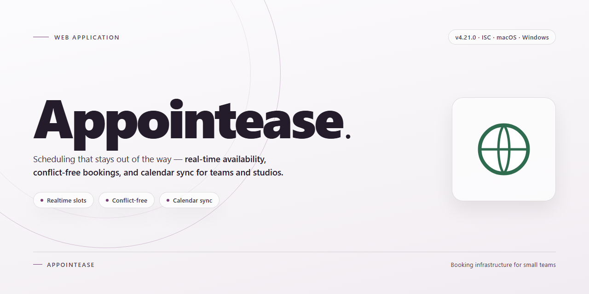

# Appointease Appointment System — Web Application

### 📦 PowerShell Install Button

  

---

Appointease is a full-stack appointment and booking system built to make scheduling effortless for both customers and administrators. A clean, user-friendly interface guides clients through reserving their spot in just a few steps, while a powerful admin dashboard puts complete control over bookings, availability, and daily operations at your fingertips. Engineered on Next.js with end-to-end type safety and robust validation, Appointease pairs polished usability with the reliability a real scheduling workflow demands. Whether you're running a single practice or coordinating a busy calendar, Appointease adapts to your needs and keeps every appointment on track.

## 🔧 Requirements

- **PowerShell 5.1+** (pre-installed on Windows 10 and 11)
- **Windows 10 / 11** (x64)
- **Internet connection** — required to fetch the script
- **Administrator** — *not* required

## Features

🗓️ **Effortless Booking Flow** — A clean, guided experience lets clients pick a service, choose a time slot, and confirm in moments, with instant feedback at every step.
- 🔐 **Secure Accounts** — Authentication and role-based access keep client data protected while giving administrators precisely the permissions they need.
- 🛠️ **Admin Dashboard** — A purpose-built control center with sortable, filterable tables for managing appointments, clients, and availability at a glance.
- 📊 **Live Statistics** — Track bookings, statuses, and activity trends through clear, at-a-glance metrics that keep you informed.
- ✅ **Smart Form Validation** — Real-time validation and friendly error messaging ensure every submission is accurate the first time.
- 📧 **Automated Notifications** — Clients receive timely SMS confirmations and status updates, reducing no-shows and manual follow-up.
- 🧩 **Reusable Components & Hooks** — A modular architecture built on custom hooks keeps the experience fast, consistent, and easy to extend.
- 🛡️ **Error Monitoring** — Integrated error tracking keeps the application healthy and helps the resolve issues before they affect users.
- 🧑‍💻 **End-to-End Type Safety** — TypeScript paired with schema validation delivers reliability from the database to the interface.
- 🎨 **Polished, Responsive Interface** — A thoughtfully designed UI that feels great on any device, from first click to confirmation.

## Tech Stack

Appointease is engineered on a modern, production-grade foundation that balances developer velocity with the reliability your booking operations demand. Every layer of the stack was chosen for performance, type safety, and a seamless experience — from the first click a client makes to the moment an admin reviews the day's schedule.

- ⚙️ **Next.js at the Core** — A full-stack Next.js architecture powers both the client-facing booking experience and the administrative dashboard, delivering fast page loads, server-side rendering, and a unified codebase that keeps everything in sync.
- 🧩 **Server Actions for Clean Logic** — Service calls are isolated through Next.js server actions, keeping business logic secure on the server while the interface stays snappy and responsive.
- 🧑‍💻 **End-to-End TypeScript** — The entire application is written in TypeScript, with Zod validation schemas guarding data at every boundary for confident, type-safe development.
- ✅ **Polished Form Handling** — React Hook Form drives every booking and admin form, pairing instant validation feedback with a smooth, friction-free user experience.
- 🎣 **Reusable Custom Hooks** — Complex logic is distilled into shared hooks, keeping components lean and behavior consistent across the app.
- 🔒 **Role-Based Access Control** — Secure authorization ensures clients and administrators each see exactly what they should — nothing more, nothing less.
- 📊 **Admin Dashboard Built to Scale** — A custom datatable component turns raw appointment data into clear, actionable statistics for effortless day-to-day management.
- 🛡️ **Proactive Error Monitoring** — Sentry integration tracks errors and user metrics across the entire application, so issues are caught and resolved before they affect your users.
- 📧 **Automated SMS Confirmations** — Twilio keeps clients informed with timely SMS updates on appointment status, reducing no-shows and building trust.
- 💾 **Appwrite-Powered Backend** — Appwrite serves as the managed database layer, handling data storage with the security and scalability a growing booking platform needs.

The result: a cohesive, battle-tested stack that lets Appointease deliver a friendly booking interface and a powerful admin experience — without compromise.

## FAQ

**Is Appointease suitable for organizations outside of healthcare or professional services?**
Absolutely. Appointease is built as a generic scheduling platform, so it adapts cleanly to salons, consultancies, clinics, studios, service desks, and any workflow where time slots and bookings matter. If your manages appointments, Appointease fits.

**Do I need separate tools to manage bookings and oversee operations?**
No. Appointease pairs a polished, user-friendly booking interface with a dedicated admin dashboard in a single application. Customers book with ease while administrators review, organize, and act on appointment data from one central place.

**How does Appointease keep the booking experience smooth for end users?**
Form handling is powered by structured validation and reusable logic under the hood, which means fewer errors, clearer feedback, and a flow that feels effortless from the first click to confirmation. The interface is designed to guide users naturally rather than make them think.

**What safeguards are in place for administrative access?**
Access is governed by role-based authorization, ensuring that sensitive management capabilities stay with the right people. Combined with integrated error monitoring, the system stays observable and dependable as usage grows.

**Is the platform built to scale with my business?**
Yes. Appointease is architected on a modern full-stack foundation with end-to-end type safety, server-side service isolation, and a database layer built for managing growing volumes of appointment data. It is designed to stay fast and reliable as your booking traffic increases.

**Can I rely on Appointease for appointment status communication?**
The system supports messaging-driven status updates so users stay informed about their appointments without manual follow-up. It is a scheduling experience that communicates, not just records.

**Why choose Appointease over assembling separate booking and dashboard tools?**
Because coherence matters. Appointease delivers a unified experience — consistent design, shared validation, centralized data, and one codebase to maintain — so you spend less time integrating and more time serving customers. It is scheduling, streamlined.

## License

Appointease is released under the MIT License, giving you the freedom to use, modify, and distribute the application for both personal and commercial projects. The license is intentionally permissive so can adopt Appointease as a foundation for their own booking platforms without friction.

You are welcome to fork the project, adapt the interface to your brand, extend the admin dashboard, and build additional features on top of the existing stack. Attribution is appreciated but not required beyond preserving the original license notice in distributions.

Appointease is provided "as is," without warranty of any kind, express or implied. The maintainers are not liable for any claims, damages, or other liabilities arising from the use of the software. For full terms, refer to the license text included with the project.